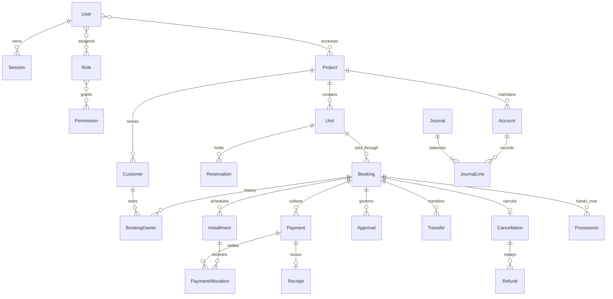

# PMS backend architecture and implementation design

The service is a modular monolith. One versioned Express API serves web, Electron, and Capacitor clients. PostgreSQL is the authority for identity, inventory, ownership and money. Redis supplies distributed throttling, scoped caching and BullMQ delivery. Private S3 objects contain documents and exports.

HTTP adapters validate Zod contracts and authorize permissions. Domain services perform transitions inside serializable transactions. Prisma handles data access. Transactions retry serialization conflicts; immutable journals, unique active inventory claims and a transactional outbox protect business consistency.

## Entity relationship and schema plan

UUID identifiers are independent from human references. Money is NUMERIC(18,2), serialized as strings. Financial operations use Prisma.Decimal. Customer identity numbers use AES-256-GCM encryption and keyed HMAC search indexes. Customer identity is unique per project; duplicate purchases reuse the same customer. Inventory hierarchy is represented by optional phase, block, tower, sector and floor attributes. Price, unit state, ownership and schedule changes retain history.

## Authorization design and project permission matrix

JWTs contain only user/session identifiers, issuer, audience and expiration. Verification checks the current database session and user. Refresh tokens are opaque, hashed, rotated under a database lock and grouped in a session family. Reuse revokes the entire family. Web refresh uses a path-scoped HttpOnly cookie with origin validation; explicit native routes return refresh tokens for OS secure storage. Platform labels are metadata only.

Roles are seeded as editable collections of permissions. Super Admin receives all permissions and explicit project assignments; it does not bypass project isolation. Global user/role administration is separate from project grants.

| Role               | Default capabilities                                 |
| ------------------ | ---------------------------------------------------- |
| Super Admin        | All permissions; project membership still enforced   |
| Management         | Read business data, reports and approve operations   |
| Project Manager    | Project inventory, customers, approvals, reports     |
| Sales Manager      | CRM, customers, reservations, bookings, discounts    |
| Sales Executive    | CRM, customer creation, reservations, booking drafts |
| Finance Manager    | Finance, payment verification/reversal, refunds      |
| Finance Officer    | Payment entry and finance reading                    |
| Recovery Officer   | Recovery cases, installments and customer reading    |
| Customer Service   | Customer, document and possession operations         |
| Dealer Coordinator | Dealer management and commission requests            |
| Auditor            | Read-only business, finance and audit access         |

## Workflow rules

Units: AVAILABLE → RESERVED → BOOKED → SOLD → TRANSFER_PENDING → SOLD; SOLD → POSSESSION_READY → POSSESSED. Administrative blocking only permits AVAILABLE ↔ BLOCKED. Reservation release returns AVAILABLE. Booking cancellation releases inventory without deleting history. Unit locks serialize competing reservations, confirmations, transfers and cancellations.

Bookings: DRAFT → CONFIRMED → CANCELLED. Confirmation requires a valid inventory claim, approved discount and booking approval, and cleared down payment. Only cleared payments allocate to installments and issue receipts. Payment reversal removes the effect of allocations and creates an inverse journal; original records remain. Schedules cannot be revised while money is allocated to affected rows.

Approvals: PENDING → APPROVED or REJECTED, with sequential levels and permission checks. Self approval is disallowed. Each final business operation rechecks state and consumes its own approval in the same transaction.

NDC issuance requires zero outstanding dues and verified identity/documents. Transfers require an unexpired NDC, approved transfer and verified transfer-charge settlement. Cancellation deducts only the explicitly approved amount. Staged refunds cannot exceed the remaining refundable balance. Possession requires settled dues, inspection, resolved snags and approval.

## Financial consistency

All amounts use Decimal; proportional installments put rounding remainder in the last installment. Idempotency keys are scoped to actor and operation and bound to the request hash. A retry returns the original resource; a different payload conflicts. PostgreSQL constraints protect active unit claims and unique receipts/commissions. Journal posting locks its accounting period, validates accounts and balances exact totals. Closed periods reject posting and reversal. Operational collections post to customer advances by default; booking does not recognize revenue. Account mappings are configurable per project.

## Endpoint inventory and implementation sequence

The generated OpenAPI document is the executable endpoint inventory. Domain routes cover authentication and devices; users, roles and project access; projects and units; customers and CRM; reservations and bookings; plans, installments and collections; recovery and dealers; approvals, NDC, transfers, cancellation, refunds and possession; accounting, documents, notifications, dashboard and reports. All project resources use `/api/v1/projects/{projectId}/...` to make scope explicit.

Implementation proceeds through foundation; sales; collections; ownership workflows; finance and delivery integrations; then security, integration tests and deployment. Tests exercise real PostgreSQL and Redis. External delivery providers require configured credentials and report failures rather than fabricated success.
